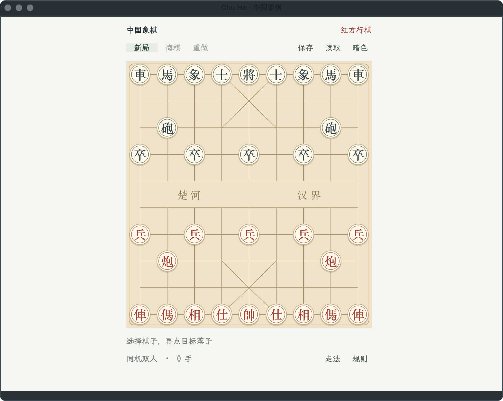
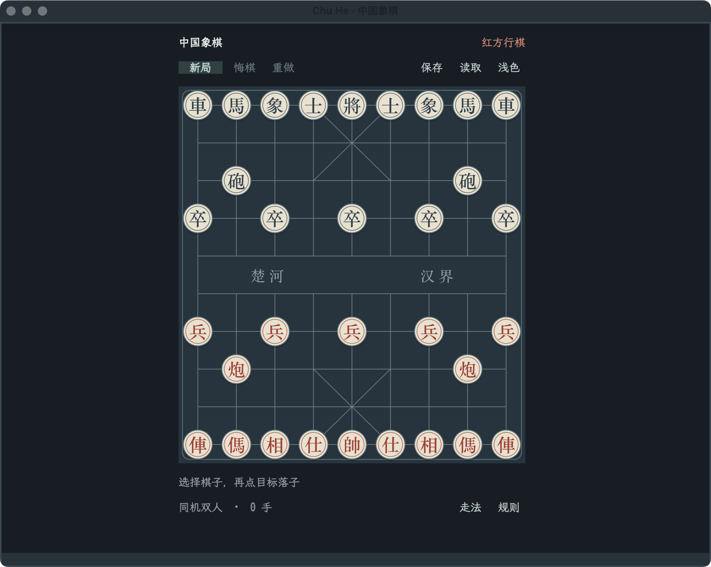

# Chu He · 中国象棋

Chinese chess (xiangqi) with a native ETAF board and the OpenSpiel rule engine,
built as an independent [GameKit](https://github.com/emacs-taf/etaf-gamekit)
application. Play the computer or a friend: pick a stone, click a highlighted
point, and the bridge answers for the computer's side or hands the turn to the
other local player.

OpenSpiel owns legality, check, repetition and history, and its adapter owns the
computer's search; this application owns the board, both palettes, selection,
the move list, the opponent settings and the launcher. It never re-implements a
move.





## Capabilities

- A native board for the OpenSpiel xiangqi rule set with an optional legal-move
  list beside the board.
- A computer opponent in easy, normal and hard search levels. It moves by itself
  on its turn, and the opponent dialog switches sides or hands both sides to
  local players without restarting the match.
- Hot-seat play in one window; after every accepted move the view switches to
  the side to move.
- Paper and night palettes; switching the theme never resets the match.
- Undo and redo that restore the turn (against the computer, one step restores
  your own last round), and explicit local snapshots through `C-s` and `C-o`.

## Prerequisites

| Requirement | Why | Check |
| --- | --- | --- |
| Emacs 29.1 or newer | the ETAF runtime | `emacs --version` |
| `ecss`, `ebox`, `etaf`, `etaf-ui` | the framework and catalog components | every root entry is on `load-path` |
| `etaf-gamekit` and its OpenSpiel backend | rule engine, game instance and state publication | `make -C etaf-gamekit engine-openspiel GAMEKIT_PYTHON=python3.11` |
| Python 3.11 or newer | the OpenSpiel runtime | `python3.11 --version` |

## Installation

```sh
git clone https://github.com/emacs-taf/ecss.git
git clone https://github.com/emacs-taf/ebox.git
git clone https://github.com/emacs-taf/etaf.git
git clone https://github.com/emacs-taf/etaf-ui.git
git clone https://github.com/emacs-taf/etaf-gamekit.git
git clone https://github.com/emacs-taf/etaf-xiangqi.git
make -C etaf-gamekit engine-openspiel GAMEKIT_PYTHON=python3.11
```

Add every provider root and this repository to `load-path`:

```elisp
(add-to-list 'load-path "/path/to/ecss")
(add-to-list 'load-path "/path/to/ebox")
(add-to-list 'load-path "/path/to/etaf")
(add-to-list 'load-path "/path/to/etaf-ui")
(add-to-list 'load-path "/path/to/etaf-gamekit")
(add-to-list 'load-path "/path/to/etaf-xiangqi")
(require 'etaf-xiangqi)

(global-set-key (kbd "C-c x") #'etaf-xiangqi-open)
```

`M-x etaf-xiangqi-open` starts an independent match and fits the board to its
window; it accepts an optional integer seed for a reproducible opening.

## Keys

| Input | Action |
| --- | --- |
| Click a stone / `Enter` | Select it and highlight its legal targets |
| Click a highlighted point | Submit that native move |
| 走法 → select a move | Open the legal-move list and submit that move directly |
| `U` / `Y` | Undo or redo the last local round (one move each in hot-seat play) |
| `N` or New match | Start a fresh match with a random seed |
| `O` or 设置 | Choose the opponent (hot-seat, computer sides) and difficulty |
| `C-s` / `C-o` | Save or load an explicit local snapshot |
| `T` or Light–Dark | Switch between the paper and night palettes |
| `F1` or Help | Open the rules dialog |
| `Q` | Close the match |

Red (bottom) moves first. `etaf-xiangqi-opponent` chooses who plays which side
in new matches: `computer-black` (the default, with the human on red),
`computer-red`, or `hot-seat`; `etaf-xiangqi-level` selects `easy`, `normal`
(the default) or `hard`. Both are switchable at runtime from the opponent
dialog. `etaf-xiangqi-appearance` selects the initial palette: `auto`, the
default, follows the frame's background mode. Short windows remove vertical
gaps and keep the board scrolled rather than stretched, and closing makes no
implicit save.

## Checks

```sh
make check   # structure, compilation, API and real-backend behavior scenarios
```

The [manual](docs/manual.md) documents the maintained GUI acceptance workflow
separately.

## Documentation

- [Chu He manual](docs/manual.md) — the board, window adaptation and GUI
  acceptance.
- [Package entry](etaf-xiangqi.el) — the supported API inventory.
- [GameKit](https://github.com/emacs-taf/etaf-gamekit) — the shared game
  framework, its adapters and backend installation.

## License

GPL-3.0-or-later; see [LICENSE](LICENSE).
